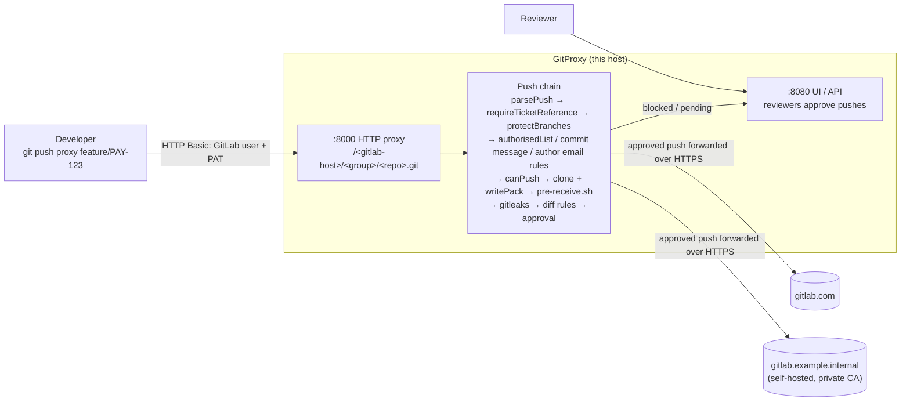

# GitProxy in front of GitLab: example policies

A self-contained reference kit for fronting **gitlab.com** and a **self-hosted GitLab** with
GitProxy. Nothing here changes GitProxy itself; everything is configuration, two push plugins, one
pull plugin and a pre-receive hook.

```text
examples/gitlab/
├── proxy.config.gitlab.json        # GitProxy config (validated against config.schema.json in CI)
├── hooks/pre-receive.sh            # size / extension / sensitive-path / docs-only rules
└── plugins/
    ├── package.json                # sample plugin package (ESM)
    ├── lib/policies.js             # pure helpers shared by the plugins (unit tested)
    ├── require-ticket-reference.js # push plugin
    ├── protect-branches.js         # push plugin
    └── restrict-group-clones.js    # pull plugin
```

Tests live in `test/examples/gitlab/` and run as part of `npm test`.

## Architecture



How routing works: the path after the proxy host names the upstream. For
`http://localhost:8000/gitlab.com/acme-bank/platform/payments-api.git` GitProxy forwards to
`https://gitlab.com/acme-bank/platform/payments-api.git`. Nested groups/subgroups work unchanged.
GitProxy builds one upstream per host it finds among the repositories it knows about (the
`authorisedList` below plus anything added in the UI or via `POST /api/v1/repo`), and the upstream
is always `https://`.

## Quick start (local)

Run everything from the repository root; GitProxy resolves plugin paths and the hook relative to
its working directory.

```sh
nvm use 22 && npm ci

# gitleaks must be on PATH because api.gitleaks.enabled=true (https://github.com/gitleaks/gitleaks/releases)
gitleaks version

# GitProxy runs ./hooks/pre-receive.sh (relative to its working directory)
mkdir -p hooks && cp examples/gitlab/hooks/pre-receive.sh hooks/pre-receive.sh

# optional policy knobs (see "Policies" below)
export GITPROXY_SENSITIVE_PATH_ALLOWLIST=platform.lead@acme.example
export GITPROXY_RESTRICTED_GROUPS=gitlab.example.internal/security/restricted
export GITPROXY_RESTRICTED_GROUP_READERS=alice
export GITPROXY_HOOK_LOG=/var/log/gitproxy/pre-receive.log

npx tsx index.ts --config examples/gitlab/proxy.config.gitlab.json
```

A successful start prints, among others:

```text
Found 3 plugin modules
Loaded plugin: RequireTicketReferencePlugin
Loaded plugin: ProtectBranchesPlugin
Loaded plugin: RestrictGroupClonesPlugin
Service Listening on 8080
Initializing proxy router for origins: '["gitlab.example.internal","gitlab.com"]'
HTTP Proxy Listening on 8000
Inserting loaded plugins (2 push, 1 pull) into proxy chains      # on the first git request
```

The example uses the file-system sink (NeDB under `./.data`) so no MongoDB is needed. Before
using it for real, change `cookieSecret`, `contactEmail`, the domain regex and the repositories.

## Connecting GitLab

### gitlab.com

1. Add each repository to `authorisedList` (or in the UI / `POST /api/v1/repo`) with its full
   HTTPS URL, e.g. `https://gitlab.com/acme-bank/platform/payments-api.git`.
2. Each developer creates a **personal access token** with `read_repository` and
   `write_repository` (group/project access tokens with the same scopes also work). No `api` scope
   is needed: GitProxy only speaks the Git smart-HTTP protocol.

### Self-hosted GitLab

1. GitLab must serve Git over **HTTPS**; GitProxy always connects to `https://<host>`. Non-default
   ports are part of the host, e.g. `https://gitlab.example.internal:8443/platform/payments/api.git`
   → `http://localhost:8000/gitlab.example.internal:8443/platform/payments/api.git`.
2. If GitLab's certificate is issued by an internal CA, give Node the CA bundle when starting
   GitProxy (do **not** use `NODE_TLS_REJECT_UNAUTHORIZED=0` outside a lab):

   ```sh
   export NODE_EXTRA_CA_CERTS=/etc/pki/ca-trust/source/anchors/acme-root-ca.pem
   npx tsx index.ts --config examples/gitlab/proxy.config.gitlab.json
   ```

3. Add the repositories exactly as for gitlab.com
   (`https://gitlab.example.internal/platform/payments/api.git` is in the example config).

### Developer setup

```sh
# from an existing clone of the GitLab repository
git remote add proxy http://localhost:8000/gitlab.com/<group>/<repo>.git
# or clone through the proxy
git clone http://localhost:8000/gitlab.example.internal/platform/payments/api.git
```

Git prompts for a username and password: use the **GitLab username** and the **PAT**. GitProxy
forwards the Basic-auth header to GitLab and reuses it to clone the repository for inspection;
it does not store it. Cache it with a credential helper instead of embedding it in the URL:

```sh
git config --global credential.helper 'cache --timeout=28800'   # or store / osxkeychain / manager
# only needed if you proxy several GitLab hosts that need different tokens:
git config --global credential.http://localhost:8000.useHttpPath true
```

### GitProxy users and push permission

GitProxy identifies the pusher by the **committer email of the last commit** in the push and
looks up a GitProxy user with that email, who must have `canPush` on the repository. So:

1. Log in to the UI at <http://localhost:8080> (first start creates `admin` / `admin`; change it).
2. Create a user whose email is the developer's `git config user.email`, e.g. via the admin UI or:

   ```sh
   # the API uses CSRF protection: fetch any page first, then send the csrf cookie back
   # (URL-decoded) in the X-CSRF-Token header, keeping the cookie jar.
   POST /api/auth/create-user {"username":"dev","password":"...","email":"dev@acme.example","gitAccount":"dev-gitlab-user"}
   ```

3. Open the repository in the UI, add `dev` under **Contributors** (`canPush`) and a reviewer under
   **Reviewers** (`canAuthorise`). The API equivalents are
   `PATCH /api/v1/repo/<id>/user/push` and `PATCH /api/v1/repo/<id>/user/authorise` with
   `{"username": "..."}`.

### Push → review → approve → push again

1. `git push proxy feature/PAY-123-refunds`
2. Policy violations are rejected immediately with a message (see below). A compliant push is
   held for review and GitProxy prints a link:

   ```text
   remote: GitProxy has received your push ✅
   remote: 🔗 Shareable Link
   remote: http://localhost:8080/dashboard/push/0000000000000000000000000000000000000000__04d79d8b...
   error: failed to push some refs to 'http://localhost:8000/...'
   ```

   The `error:` line is expected: nothing has reached GitLab yet.

3. A reviewer opens the link, reads the diff, answers the attestation questions and approves.
4. The developer runs the same `git push` again and it is forwarded to GitLab:

   ```text
   To http://localhost:8000/localhost:8443/e2e-org/sample-repo.git
    * [new branch]      feature/refunds -> feature/refunds
   ```

5. The change is merged through a normal GitLab merge request.

Pushes the hook auto-approves (docs-only) skip step 3 but still need the second push.

## Policies

| Policy                          | Where                        | Result                                |
| ------------------------------- | ---------------------------- | ------------------------------------- |
| `requireTicketReference`        | push plugin                  | reject                                |
| `protectBranches`               | push plugin                  | reject                                |
| Authorised repositories         | `authorisedList`             | reject                                |
| Commit message rules            | `commitConfig.message.block` | reject                                |
| Author email rules              | `commitConfig.author.email`  | reject                                |
| Push permission                 | GitProxy user `canPush`      | reject                                |
| Large files, binaries           | `hooks/pre-receive.sh`       | auto-reject                           |
| `restrictSensitivePaths`        | `hooks/pre-receive.sh`       | auto-reject, or review if allowlisted |
| Docs-only changes               | `hooks/pre-receive.sh`       | auto-approve                          |
| Secrets (gitleaks)              | `api.gitleaks`               | reject                                |
| Secrets and markers in the diff | `commitConfig.diff.block`    | reject                                |
| Everything else                 | attestation + reviewer       | manual approval                       |

### requireTicketReference (push plugin)

Every commit in the push must reference a ticket: a Jira key (`PAY-123`) or a GitLab issue
(`#42`). Merge commits (`Merge branch ...`) are exempt.
Override the regex with `GITPROXY_TICKET_PATTERN` (JavaScript regex source), for example
`GITPROXY_TICKET_PATTERN='^(PAY|RISK)-\d+: '` to require a project key prefix.

```text
remote: Your push has been blocked by policy "requireTicketReference".
remote: Every commit message must reference a ticket, e.g. "PAY-123: ..." (Jira) or "... #42" (GitLab issue).
remote: Commits without a ticket reference:
remote:   - "add refund calculation" <dev@acme.example>
remote: Reword them with `git rebase -i` (or `git commit --amend`) and push again.
```

### protectBranches (push plugin)

Blocks direct pushes to `main`, `master` and `release/*`; changes reach them through GitLab merge
requests. Override with `GITPROXY_PROTECTED_BRANCHES` (comma separated globs, `*` = one path
segment, `**` = any depth), e.g. `main,release/**,hotfix/*`.

```text
remote: Your push has been blocked by policy "protectBranches".
remote: "main" is a protected branch (matches "main"); direct pushes are not allowed.
remote: Push a feature branch instead and open a GitLab merge request, e.g.
remote:   git push proxy HEAD:refs/heads/feature/PAY-123-short-description
```

### restrictSensitivePaths (pre-receive hook)

Changes to `.gitlab-ci.yml`, `CODEOWNERS` or anything under `.gitlab/` are rejected unless the
pusher is in `GITPROXY_SENSITIVE_PATH_ALLOWLIST` (comma separated committer emails); allowlisted
changes still always go to manual review.

This is implemented in the hook rather than as a plugin on purpose: push plugins run straight
after `parsePush`, before GitProxy has cloned the repository and applied the pack, so only commit
metadata (messages, authors, branch) is available there, not the list of changed files. The hook
runs inside the clone after `writePack` and can use `git diff-tree`. Override the paths with
`GITPROXY_SENSITIVE_PATH_PATTERN` (extended regex).

### Pre-receive hook: size, binaries, docs-only

`hooks/pre-receive.sh` reads `<old> <new> <ref>` on stdin and inspects every file added or
modified by any commit in the pushed range:

| Exit | Meaning       | When                                                                                                                                                                                                                                                                     |
| ---- | ------------- | ------------------------------------------------------------------------------------------------------------------------------------------------------------------------------------------------------------------------------------------------------------------------ |
| `1`  | auto-reject   | a file is larger than `GITPROXY_HOOK_MAX_FILE_BYTES` (default 5 MiB), has a blocked extension (`GITPROXY_HOOK_BLOCKED_EXTENSIONS`, default executables, archives, `.jar/.class/.pyc`, `.p12/.pfx/.jks/.keystore`), or touches a sensitive path without being allowlisted |
| `0`  | auto-approve  | every changed file matches `GITPROXY_DOCS_PATH_PATTERN` (default `*.md` and `docs/**`)                                                                                                                                                                                   |
| `2`  | manual review | anything else, and anything the hook cannot evaluate (fails closed)                                                                                                                                                                                                      |

GitProxy only looks at the exit status and does not show the hook output to the developer or in
the UI. An auto-rejected push shows the same "GitProxy has received your push" link as a pending
one; the push page shows it as rejected. Set `GITPROXY_HOOK_LOG` to keep the reasons:

```text
2026-09-28T18:18:01Z sample-repo.git refs/heads/docs/refund-runbook@ee4555c9... auto-approved: documentation-only change (1 path(s))
2026-09-28T18:16:40Z sample-repo.git refs/heads/feature/ci-change@1b40db5a... REJECTED: dev@acme.example may not modify protected paths: .gitlab-ci.yml
```

### Commit metadata rules (config)

- `commitConfig.author.email.domain.allow`: author emails must be `@acme.example` or
  `@eng.acme.example`.
- `commitConfig.author.email.local.block`: rejects `noreply`, `root`, `admin`, `gitlab`, `ci`,
  `bot` and similar shared identities, and `+` sub-addresses (GitLab's
  `12345-user@users.noreply.gitlab.com` style addresses fail the domain rule anyway).
- `commitConfig.message.block`: rejects `WIP`/`Draft` subjects, `fixup!`/`squash!`/`amend!`
  commits, `DO NOT MERGE` in any spelling, `[skip ci]`/`[ci skip]` and "temp commit".

### Secret scanning (config)

- `commitConfig.diff.block.providers`: GitLab PATs (`glpat-`), runner tokens (`glrt-`), deploy
  tokens (`gldt-`), pipeline trigger tokens (`glptt-`) and AWS access key IDs.
- `commitConfig.diff.block.patterns`: PEM/OpenSSH/PGP private key headers.
- `commitConfig.diff.block.literals`: internal markers such as `ACME-CONFIDENTIAL` and an
  internal-only registry path.
- `privateOrganizations`: repositories whose URL contains `platform/security-test-fixtures` are
  exempt from the diff rules (they intentionally contain fake credentials).
- `api.gitleaks`: runs `gitleaks` on the pushed range. **The `gitleaks` binary must be on
  GitProxy's `PATH`**, otherwise every push fails at the gitleaks step. Remove the block or set
  `enabled: false` if you cannot install it.

### Attestation (config)

Reviewers must confirm four statements before approving: the diff matches the ticket, no
credentials or customer data (PII/PCI), the code may leave the network, and a separate GitLab MR
approval will be used for protected branches (segregation of duties).

### restrictGroupClones (pull plugin, optional)

Logs every clone/fetch of a repository under a group in `GITPROXY_RESTRICTED_GROUPS`
(e.g. `gitlab.example.internal/security/restricted`) and blocks it unless the Basic-auth username
is in `GITPROXY_RESTRICTED_GROUP_READERS`. The token itself is never logged.

```text
$ git clone http://testuser:<PAT>@localhost:8000/localhost:8443/test-owner/test-repo.git
fatal: invalid ls-refs response: ?	Clone/fetch blocked by policy "restrictGroupClones": localhost:8443/test-owner is a restricted group and "testuser" is not on the reader allowlist.
```

The username is whatever the client sends; GitLab checks the token, not GitProxy. Treat this as an
audit trail on top of GitLab group permissions, not a replacement. Pull plugins run on the
`git-upload-pack` request (the actual fetch), not on the ref advertisement, so `git ls-remote`
still works against GitLab's own permissions.

## Enforcement: GitLab must not be reachable around the proxy

GitProxy only controls traffic that goes through it. Developers already have PATs that work
directly against GitLab, so lock GitLab down as well:

- **Network egress**: block direct HTTPS/SSH from developer networks to `gitlab.com` (or the
  self-hosted instance) and allow it only from the GitProxy hosts.
- **GitLab IP allowlisting**: gitlab.com Premium/Ultimate groups can restrict access by IP
  address (_Group → Settings → General → Permissions → Restrict access by IP address_); self-hosted
  instances can do the same at the load balancer. Allow only GitProxy's egress IPs.
- **Protected branches and MR approvals**: protect `main`/`release/*` in GitLab so that even an
  approved GitProxy push can only land on a feature branch, and require MR approvals there.
- **Disable SSH Git access** (or restrict SSH keys): GitProxy does not proxy SSH.

## Known limitations

- **HTTPS only**: upstreams must be `https://`; SSH remotes are not supported.
- **Identity is the last committer email**, not the authenticated GitLab user. A developer can set
  any `user.email`; the author-email rules, `canPush` lookup and the hook's allowlist all trust it.
  Combine with GitLab's _Reject unverified users_ / _Check whether the commit author is a GitLab
  user_ push rules and commit signing.
- **No GitLab API integration**: GitProxy does not open or read merge requests, pipelines,
  approvals or group membership.
- **Hook output is not surfaced**: see the pre-receive section; use `GITPROXY_HOOK_LOG`.
- **Plugins only see commit metadata**: file-level rules belong in the pre-receive hook.
- **Environment knobs are read per request** from the GitProxy process environment; restart
  GitProxy after changing them if they are set in a service unit.
